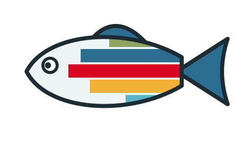
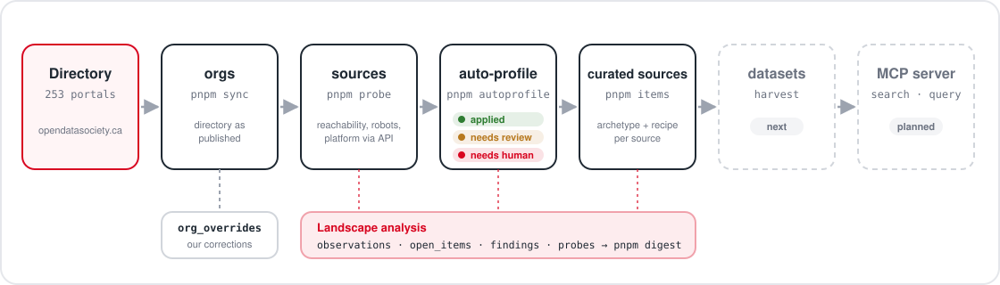

<div align="center">



# CODD AI

**Canada Open Data Directory AI**

A registry, connectors and an MCP server so AI agents can find and query the open data behind the [Canadian Open Data Directory](https://directory.opendatasociety.ca/directory).

[](LICENSE)
[](package.json)
[](tsconfig.json)
[](src/db.ts)
[](docs/PLAN.md#mcp-surface-draft)
[](NEXT.md)

[](https://directory.opendatasociety.ca/directory)
[](docs/PLAN.md)
[](https://github.com/baobab-tech/codd-ai/releases/tag/db-latest)
[](https://opendatasociety.ca)

[How it works](#how-it-works) · [Getting started](#getting-started) · [Design](docs/PLAN.md) · [Reuse it](REUSE.md) · [Work queue](NEXT.md)

</div>

---

Built in collaboration with the [Canadian Open Data Society](https://opendatasociety.ca). [Baobab Tech](https://baobabtech.ai), a corporate member of the Society, is providing technical leadership for this project. Code is MIT licensed.

## The problem

The directory lists 253 Canadian organizations that publish open data: municipalities, provinces, federal agencies, universities, non-profits. Together they report about 105k datasets. The directory itself holds no datasets. Each entry points to a portal, and the portals vary widely:

- **Catalog platforms with APIs:** CKAN, ArcGIS Hub, Socrata, Opendatasoft, Dataverse, GeoNetwork.
- **Bespoke APIs:** Statistics Canada WDS, Bank of Canada Valet, city-built portals.
- **Esri map servers** with no catalog in front of them.
- **Static web pages** linking ZIPs, CSVs and PDFs.
- **Dead links, bot walls, and sites that need a browser.**

An agent can't use "the directory" directly. It needs to know, for each source, how to list what is there and how to get at the data.

## How it works

<p align="center"></p>

1. **Sync** (`pnpm sync`). The directory has no API. Its org list is a CSV embedded in the site's JS bundle. The sync walks the bundle, extracts the CSV, and loads it into `orgs` unchanged. Corrections live in `org_overrides`, never in `orgs`.
2. **Probe** (`pnpm probe`). For each org URL: reachability, redirects, TLS, bot-protection signatures, and robots.txt rules for AI crawlers. Then it fingerprints the platform through its API, not the HTML: CKAN, ArcGIS Hub, ArcGIS Server, Socrata, Opendatasoft, Dataverse, GeoNetwork, DCAT. The result is a `sources` row (platform, API base, scope inside a shared portal, live dataset count). Problems become `open_items`.
3. **Auto-profile** (`pnpm autoprofile`). For orgs with no recognized API, it reads the landing page and a few data pages, and fingerprints the portals they link to. It counts data and document files and looks for JSON APIs. Each source then gets an archetype (`platform_api`, `known_api`, `esri_rest`, `web_listing`, `js_app`, `document_library`, `not_data`) and is routed to one of:
   - **applied**: a known platform answered; nothing to review.
   - **needs_review**: a Claude session verifies it (inspects a JS app in a browser, confirms a file listing, finds the org inside a shared portal).
   - **needs_human**: a person decides (document libraries, pages with no data, which ArcGIS folders are open data).
4. **Review** (`pnpm items`, `pnpm profile-source`). Reviewers confirm the archetype and write a `recipe` (JSON connector settings). Reviewed sources are marked `curated`, and the probe never overwrites them.
5. **Harvest** (next). One connector per platform or archetype lists datasets and resources into the database. Each resource gets a tier: live query, tabular file, geo file, document, or link only.
6. **MCP** (planned). A TypeScript MCP server for searching datasets, inspecting them, and querying resources, either live through the source API or through DuckDB over a downloaded file.

The detailed design is in [docs/PLAN.md](docs/PLAN.md). To run this against a different directory of portals, see [REUSE.md](REUSE.md).

### Landscape analysis

Every step records what it learns about how agent-friendly Canadian open data is:

- `observations`: structured facts per org (access, robots.txt, API, landing page).
- `findings`: narrative discoveries, one quotable fact each, added with `pnpm note`.
- `open_items`: the work queue (blockers, dead links, wrong directory labels, `needs_review`, `needs_human`).

`pnpm digest` collects all of it into one markdown file, the input for a one-page landscape report. See [reports/](reports/).

## Getting started

Requires Node 22+, pnpm, and the GitHub CLI (`gh`) for downloading the database.

```bash
pnpm install
pnpm db:pull                 # download the latest published database
pnpm sql "select platform, count(*) from sources group by 1"
pnpm digest                  # landscape digest to stdout
```

## The database

All state lives in one DuckDB file, `db/codd.duckdb`. It is not committed. It is published as an asset on the [`db-latest` release](https://github.com/baobab-tech/codd-ai/releases/tag/db-latest), with a dated `db-YYYYMMDD-HHMMSS` release kept for each snapshot.

| Table | Holds |
|---|---|
| `orgs` | The directory, as published |
| `org_overrides` | Our corrections to directory fields, with reasons |
| `sources` / `org_sources` | How to connect to each data source, and which orgs it serves |
| `connectors` | Access methods, shared across sources |
| `observations` | Structured facts from probing |
| `findings` | Narrative discoveries |
| `open_items` | Work queue |
| `probes` | Raw HTTP evidence |

Maintainers publish with `pnpm db:publish -m "what changed"`. Only one person or session should write at a time.

## Commands

| Command | Does |
|---|---|
| `pnpm sync` | Re-pull the directory into `orgs` |
| `pnpm probe [--only id,id]` | Probe org URLs and fingerprint platforms |
| `pnpm autoprofile [--only id,id] [--dry-run]` | Profile and route sources the probe couldn't identify |
| `pnpm items [kind]` | List the work queue; `pnpm items resolve <id> "why"` closes an item |
| `pnpm profile-source <org> ...` | Record a reviewed (curated) source |
| `pnpm note "..."` / `pnpm note --list` | Record or list findings |
| `pnpm digest [--out file]` | Landscape digest |
| `pnpm sql "..."` | Ad-hoc SQL against the database |
| `pnpm db:pull` / `pnpm db:publish` | Download / publish the database |
| `pnpm db:export` / `pnpm db:import` | Optional JSONL copy of the small tables, for readable diffs |

## Crawling etiquette

The probe sends requests to a host one at a time, 500 ms apart, with a `codd-ai` user agent that links to this repository. A browser user agent is used only to test whether a block depends on the user agent, and that result is recorded. We read robots.txt and record its rules. Whether a robots.txt `Disallow` should apply to documented public APIs is an open question, tracked in `open_items`.

## Status

Early. Directory sync, probing and auto-profiling work: 210 of 253 orgs have an identified source, 30 are in the review queue, and 13 have a dead link or no URL. Connectors, harvesting and the MCP server are next. [NEXT.md](NEXT.md) is the working log and has the current to-do list.

## Reuse

Only the directory sync is specific to this directory. [REUSE.md](REUSE.md) explains how to fork this for another meta-catalog.

## Licence

Code: [MIT](LICENSE).

`data/directory/` holds a snapshot of the Canadian Open Data Directory, maintained by the Canadian Open Data Society. Datasets reached through the connectors stay under their publishers' own licences.
