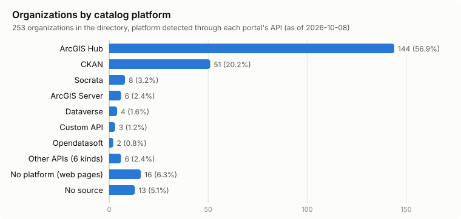
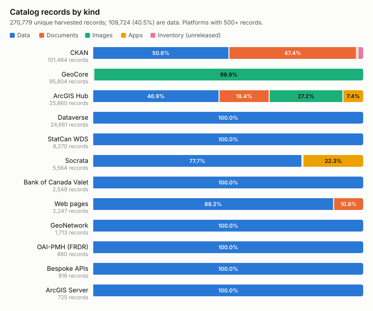
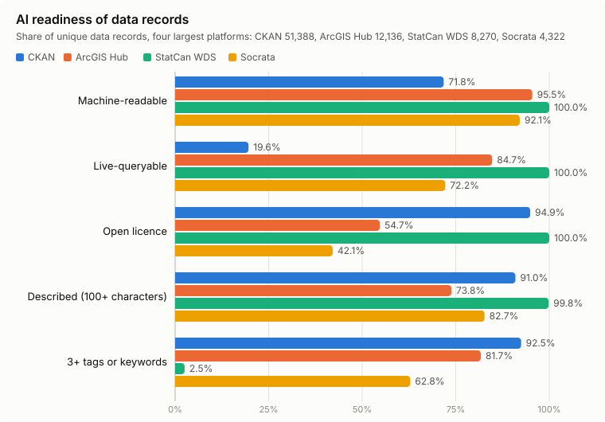
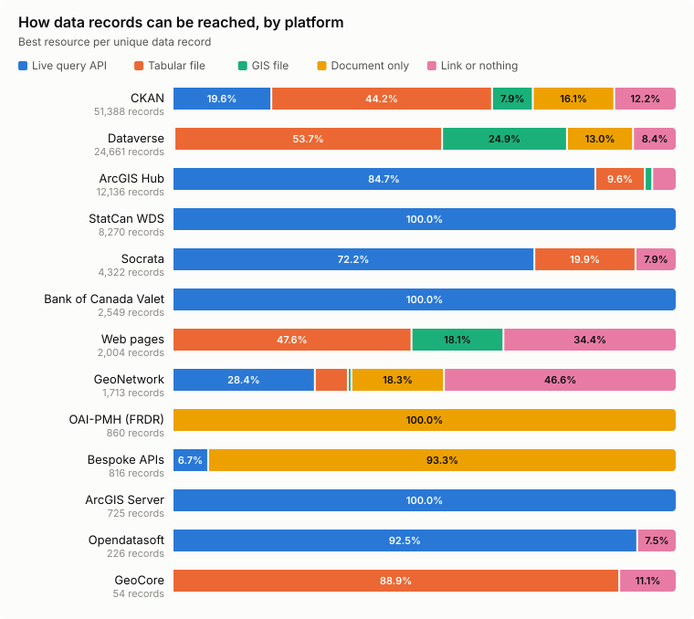
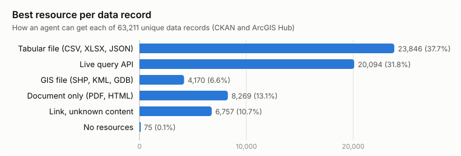
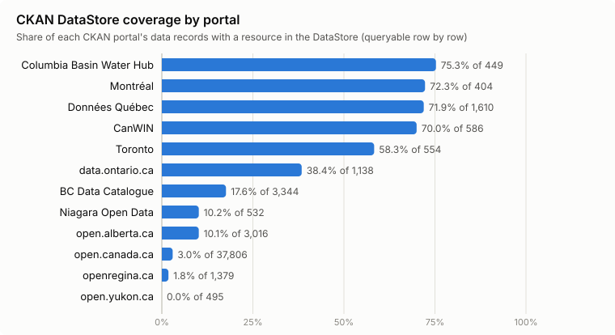
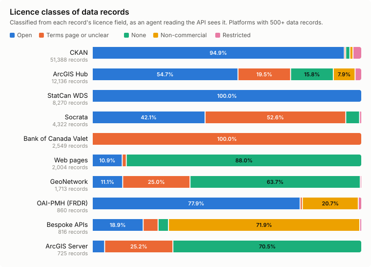
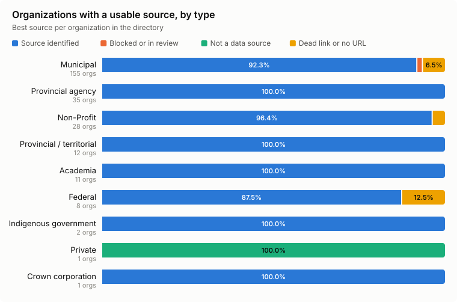
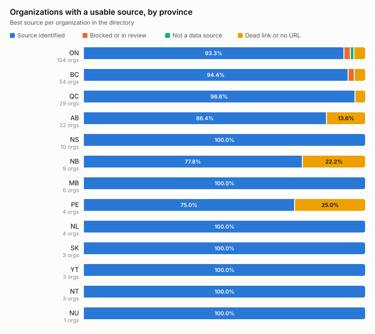
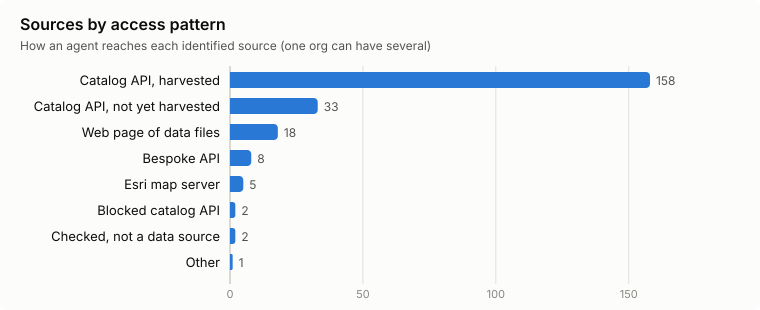

# Canadian Open Data Directory: landscape report

**As of 2026-10-08.** CODD AI checked all 253 organizations in the [Canadian Open Data Directory](https://directory.opendatasociety.ca/directory): reachability, bot protection, robots.txt, and which catalog API each portal actually runs. It then harvested the catalog of every source it could reach, through 11 catalog platforms and APIs, 4 bespoke APIs and 18 web pages of files, and scored each record for AI readiness. For live-queryable data it also read each table's columns, row count and sample rows. Every number below comes from [the digest for this date](digest-2026-10-08.md). Earlier digests: [2026-10-06](digest-2026-10-06.md) (CKAN and ArcGIS Hub only), [2026-10-04](digest-2026-10-04.md) (portal checks only).

## Summary

- **The directory lists publishers, not datasets.** 253 organizations report 104,617 datasets between them. The counts are self-reported, mostly dated February 2025, and missing for 46 orgs.
- **93% of organizations have a source an agent can read.** 236 orgs have a working catalog API or a confirmed listing method. 3 are blocked (Hamilton, Quinte West, UBC's Abacus), 1 is not a data source, and 13 have a dead or wrong link.
- **The catalogs hold 270,779 unique records; 109,724 are data.** The rest are single images and satellite scenes (102,791), documents (53,105), apps (3,333) and entries for unreleased data (1,826).
- **Most data is machine-readable, a third is live-queryable.** 78.9% of data records have a CSV, spreadsheet, GIS file or query API. 33.0% can be queried live, without downloading a file.
- **Licensing is the main barrier.** 71.2% of data records carry an open licence. CKAN portals and Statistics Canada are at 94.9% and 100%; ArcGIS Hub is at 54.7%, Borealis 45.5% and Socrata 42.1%, because records say "Custom Terms", "See Terms of Use" or nothing.
- **Agents can read the schema of about 25,600 live tables without downloading them.** The describe pass read columns, row counts and sample rows from 12,943 CKAN DataStore tables and 12,692 Esri layers, holding 769 million rows between them.
- **Bot walls and robots.txt rarely get in the way.** 20 orgs challenge web pages but not their APIs. UBC's Abacus is the one API that blocked a paced harvest. 7 hosts block named AI crawlers; none names Claude's.

## Platforms

Detected through each portal's API, not the directory's label.

| Platform | Orgs | Sources harvested | Records | Unique records |
|---|---:|---:|---:|---:|
| ArcGIS Hub | 144 | 136 | 28,448 | 25,860 |
| CKAN | 51 | 12 | 149,366 | 101,484 |
| Socrata | 8 | 6 | 5,564 | 5,564 |
| ArcGIS Server (no Hub) | 6 | 4 | 725 layers | 725 |
| Dataverse | 4 | 1 | 24,661 | 24,661 |
| Bespoke APIs (Red Deer, Brandon, NatureCounts, CONP) | 3 | 4 | 816 | 816 |
| Opendatasoft | 2 | 2 | 226 | 226 |
| Statistics Canada WDS | 1 | 1 | 8,270 tables | 8,270 |
| Bank of Canada Valet | 1 | 1 | 2,549 series groups | 2,549 |
| GeoNetwork | 1 | 1 | 1,713 | 1,713 |
| GeoCore (geo.ca) | 1 | 1 | 103,387 | 95,804 |
| OAI-PMH (FRDR) | 1 | 1 | 860 | 860 |
| Web pages of files | 16 | 18 | 2,247 | 2,247 |
| No source | 13 | — | — | — |

A source can serve several orgs: Données Québec, Niagara Open Data and the Columbia Basin Water Hub each host many publishers.

Records repeat across sources in three ways, and each repeat is counted once:

- **Mirrors.** CanWIN (University of Manitoba) republishes the federal catalogue: 47,882 of its records carry open.canada.ca ids. GeoCore repeats 7,583 open.canada.ca records.
- **Shared Hub items.** 2,588 ArcGIS items appear on more than one of 18 Hub sites.
- **Scopes.** U of T's Dataverse is a collection inside Borealis and is harvested with it.

## What the catalogs hold

### Record kinds

A catalog record is not always a dataset. Each record gets a kind from the platform's own type field.

| Kind | Records | Share | Where |
|---|---:|---:|---|
| Data | 109,724 | 40.5% | Datasets with files or an API |
| Image | 102,791 | 38.0% | One record per picture or scene: 95,750 Sentinel-1 and RADARSAT scenes in GeoCore, 7,041 Hub image items (5,447 orthophoto tiles from Township of Langley, 1,426 from Grande Prairie) |
| Document | 53,105 | 19.6% | open.alberta.ca publications (34,479), open.canada.ca `info` records (10,144), Yukon reports and summaries (3,369), Hub PDFs and document links |
| App | 3,333 | 1.2% | Hub web maps and dashboards, Socrata charts, stories and filtered views (1,240) |
| Inventory | 1,826 | 0.7% | data.ontario.ca entries for data under review or restricted, with no files |

Readiness below is measured on data records only.

### Readiness of data records

| Platform | Data records | Machine-readable | Live query | Open licence | Described |
|---|---:|---:|---:|---:|---:|
| **All** | **109,724** | **78.9%** | **33.0%** | **71.2%** | **87.4%** |
| CKAN | 51,388 | 71.8% | 19.6% | 94.9% | 91.0% |
| Dataverse (Borealis) | 24,661 | 82.3% | 0% | 45.5% | 94.8% |
| ArcGIS Hub | 12,136 | 95.5% | 84.7% | 54.7% | 73.8% |
| Statistics Canada WDS | 8,270 | 100% | 100% | 100% | 99.8% |
| Socrata | 4,322 | 92.1% | 72.2% | 42.1% | 82.7% |
| Bank of Canada Valet | 2,549 | 100% | 100% | 0% | 66.5% |
| Web pages of files | 2,004 | 65.6% | 0% | 10.9% | 0% |
| GeoNetwork | 1,713 | 38.4% | 31.1% | 11.1% | 75.0% |
| OAI-PMH (FRDR) | 860 | 0% | 0% | 77.9% | 99.2% |
| Bespoke APIs | 816 | 6.7% | 6.7% | 18.9% | 89.3% |
| ArcGIS Server | 725 | 100% | 100% | 4.3% | 23.2% |
| Opendatasoft | 226 | 100% | 100% | 86.7% | 100% |

FRDR's Dublin Core records point to landing pages, not files, so its data is reachable only through its source repositories. NatureCounts and CONP are listed as metadata only, by decision: their data needs an account or ethics approval.

### How data records can be reached

| Best resource | Data records | Share |
|---|---:|---:|
| Tabular file (CSV, XLSX, JSON, TSV, SPSS, Stata) | 39,104 | 35.6% |
| Live query API | 35,762 | 32.6% |
| Document only (PDF, HTML page) | 13,407 | 12.2% |
| GIS file (SHP, GeoTIFF, KML, GDB) | 10,677 | 9.7% |
| Link with unknown content | 9,421 | 8.6% |
| No resources | 1,353 | 1.2% |

### Schema without download

Agents write better queries when they know the columns before fetching data. Three platforms give that in their catalogs: Socrata and Opendatasoft list each dataset's columns and a data-update time, and Statistics Canada documents every table. For CKAN DataStore tables and Esri layers, the describe pass queried each live table once:

| | CKAN DataStore tables | Esri layers |
|---|---:|---:|
| Described | 14,984 | 14,237 |
| Readable (columns, count, 3 sample rows) | 12,943 (86.4%) | 12,692 (89.1%) |
| Rows held | 492,352,033 | 276,988,828 |
| Median columns | 9 | 10 |
| Last data edit known | — | 7,471 (3,358 edited in the past 12 months) |

Most Esri layers return at most 2,000 rows per query (9,212 layers) or 1,000 (2,839), so agents must page. The failures say something too: 540 Esri layers answer 403 (secured), cached tile services cannot be queried at all, and CanWIN's DataStore ids stop resolving the day they are harvested.

### Live query on CKAN

Hub, Socrata, Opendatasoft and Statistics Canada data is live-queryable by default. On CKAN it depends on whether each portal loads its files into the DataStore:

| CKAN portal | Data records | In DataStore |
|---|---:|---:|
| data.cbwaterhub.ca | 449 | 75.3% |
| donnees.montreal.ca | 404 | 72.3% |
| Données Québec | 1,610 | 71.9% |
| CanWIN | 586 | 70.0% |
| Toronto | 554 | 58.3% |
| data.ontario.ca | 1,138 | 38.4% |
| BC Data Catalogue | 3,344 | 17.6% |
| open.alberta.ca | 3,016 | 10.1% |
| Niagara Open Data | 532 | 10.2% |
| open.canada.ca | 37,806 | 3.0% |
| openregina.ca | 1,379 | 1.8% |
| open.yukon.ca | 495 | 0% |

### Licences

Licences are counted as the API shows them: a portal-wide licence missing from the record does not count.

| Licence class | Data records |
|---|---:|
| Open | 78,170 |
| Terms page or unrecognized label | 17,690 |
| None | 8,286 |
| Non-commercial | 3,769 |
| Restricted (Crown copyright, access only) | 1,772 |
| No derivatives | 37 |

The largest gaps, by label:

- **"Custom Terms"** on 9,165 Borealis datasets: each depositor writes their own terms.
- **"See Terms of Use"** on most Calgary and Edmonton Socrata records (871 of 936 and 1,873 of 2,088).
- **No licence field at all** on the Bank of Canada's Valet API, Red Deer's API and most ArcGIS Server layers.
- **Terms-page links** in the licence field of Hub sites (Strathcona County, Ottawa, Port Moody).
- **Empty licence fields** on 442 of Toronto's 555 CKAN records and 1,090 of Marine Data BC's 1,713 GeoNetwork records.

Some catalogues list data that is not openly licensed by design: NatureCounts (571 collections; downloads need an account and each collection has its own sharing policy), CONP (190 neuroscience datasets whose terms require ethics approval), the Capital Regional District (no redistribution) and Metrolinx's GTFS feeds (a revocable use agreement). The registry lists these as metadata and links, with their access level, and never downloads their data.

### Strong sources

| Source | Data records | Machine-readable | Live query | Open licence |
|---|---:|---:|---:|---:|
| Statistics Canada WDS | 8,270 | 100% | 100% | 100% |
| Données Québec | 1,611 | 97% | 78% | 97% |
| donnees.montreal.ca | 405 | 95% | 73% | 98% |
| Nova Scotia (Socrata) | 881 | 95% | 81% | 99% |
| Niagara Open Data | 534 | 87% | 81% | 99% |
| Halifax (data-hrm) | 246 | 100% | 100% | 100% |
| Kingston | 246 | 100% | 100% | 100% |
| Ontario GeoHub (LIO) | 251 | 100% | 99% | 99% |

Per-source scores for every harvested source are in the [digest](digest-2026-10-08.md#readiness-by-harvested-source-unique-records-by-kind--of-its-data-records).

## Who is ready

| Type | Orgs | Ready |
|---|---:|---:|
| Municipal government | 155 | 142 |
| Provincial agency | 35 | 35 |
| Non-profit | 28 | 27 |
| Provincial / territorial government | 12 | 12 |
| Academia | 11 | 10 |
| National / federal government | 8 | 7 |
| Indigenous government | 2 | 2 |
| Crown corporation | 1 | 1 |
| Private | 1 | 0 |

Federal organizations run their own APIs instead of a catalog platform. Statistics Canada's Web Data Service lists 8,270 tables in one call, each downloadable whole or queryable by series. The Bank of Canada's Valet API serves 2,549 series groups as JSON or CSV. geo.ca sits on GeoCore. CMHC publishes inside open.canada.ca.

By province, Nova Scotia (10 of 10), Manitoba (6 of 6), Newfoundland and Labrador (4 of 4), Saskatchewan, the Northwest Territories and Yukon (3 of 3 each) and Nunavut (1 of 1) are complete. Alberta (19 of 22), New Brunswick (7 of 9), Ontario (97 of 104) and BC (51 of 54) have the most gaps, mostly dead links.

## How the data is reached

| Access pattern | Sources | Examples |
|---|---:|---|
| Catalog platform API, harvested | 158 | 12 CKAN portals, 136 Hub sites, 6 Socrata, 2 Opendatasoft, Borealis, Marine Data BC |
| Org inside a harvested portal | 33 | Données Québec and Niagara publishers, CMHC in open.canada.ca |
| Bespoke API, harvested | 8 | Statistics Canada WDS, Bank of Canada Valet, GeoCore, FRDR (OAI-PMH), Red Deer, Brandon, NatureCounts, CONP |
| Web page of data files, harvested | 18 | Saanich, Whitehorse, GeoNB, MPHEC, NL Statistics, Tribunals Ontario, NWT Geomatics, the NL open data portal |
| Esri map server, harvested | 4 | GeoNB, Surrey, Brandon, Banff (open-data folders only) |
| Blocked | 3 | Hamilton (Cloudflare challenge), Quinte West (broken Hub catalogue), Abacus (bot block) |
| Checked, not a data source | 2 | CFL (API gone), Capital Regional District's map server (no open folder) |

These patterns came up repeatedly:

- **The directory link is often a front end, not the portal.** City "open data" pages link out to a Hub site or a provincial CKAN. Gatineau, CMHC and Welland publish inside a shared portal while the directory points at their own web page.
- **The data is often one or two links past the directory URL.** Of 13 sources the auto-profile could not classify, 6 had open data a little further on: Nanaimo's Hub behind a "GIS Downloads" link, GeoNB's catalogue after a "we have moved" page, Brandon's JSON API built in the browser, Metrolinx's files inside a page's embedded JSON, MPHEC's CSV downloads and NL Statistics' Excel tables.
- **Hub sites hide from simple fingerprints.** Five Hub sites answer 404 on the search API's dataset collection while serving everything else; four had been classed as DCAT-only.
- **Esri servers mix open and internal layers.** Banff publishes an open-data folder next to pothole, graffiti and fire-department services on the same public endpoint. The Capital Regional District has 202 services and no folder marked as open data.
- **Bespoke portals can be excellent.** Red Deer's custom portal has a paged JSON API for every dataset, and Statistics Canada's WDS is the most agent-friendly source found.

## Barriers for agents

| Barrier | Orgs | Detail |
|---|---:|---|
| Dead link | 11 | Mostly deleted or renamed ArcGIS Hub sites (Brantford, Hastings County, Okotoks, Orangeville…), plus a Marine Data BC timeout |
| Bot challenge on web pages | 20 | AWS WAF on Données Québec and Figshare; APIs unaffected |
| Bot block on the API | 2 | Hamilton's Hub search API sits behind a Cloudflare challenge for every scripted client. UBC's Abacus blocked every API call after about 37 paced requests |
| Bot challenge on the data | 1 | The Nunavut Bureau of Statistics publishes its tables on gov.nu.ca behind a Cloudflare challenge; only a browser can fetch them |
| Broken catalog API | 1 | Quinte West's Hub search, DCAT feed and data.json all answer "Site catalog is not configured correctly" |
| TLS error | 1 | Canadian Space Agency serves an incomplete certificate chain; strict HTTP clients fail |
| Missing or wrong URL | 3 | Calgary has no URL; Shawinigan's points at Rouyn-Noranda; Campbell River's points at Calgary's portal |

Hub downloads of feature layers are generated on request: the first call answers HTTP 202, and the client has to poll until the file is ready.

## robots.txt and AI crawlers

- 18 hosts have no robots.txt.
- 1 disallows all crawlers: gov.pe.ca, home of PEI's legacy GIS catalogue.
- The Dataverse installs (Borealis, Abacus, U of T) use an allowlist: dataset pages, collection pages and the sitemap are allowed, and everything else, including the search API and OAI-PMH, falls under a final `Disallow: /`.
- 7 block named AI crawlers. Six are the Niagara group (Niagara Open Data, St. Catharines, Fort Erie, Lincoln, Niagara-on-the-Lake, Brock University), all blocking GPTBot, CCBot, Bytespider and Amazonbot. Birds Canada blocks Amazonbot.
- None names ClaudeBot or uses Content-Signal.

The project treats robots.txt as governing the crawling of web pages. It uses documented public APIs and OAI-PMH endpoints where robots.txt covers their paths, identifies itself and paces its requests, and records each host's rules.

## Directory data quality

- 8 platform labels are wrong. For example, Guelph and Thunder Bay are labelled CKAN but run ArcGIS Hub; PEI, PEI Water Registry and Strathcona are labelled Socrata but run Hub; Kingston is labelled Opendatasoft but runs Hub; Yukon is labelled DKAN but runs CKAN. Four other "mismatches" were our probe's error: the directory's Hub labels for Langley, New Westminster, Ottawa Police and Yukon Community Statistics are right.
- Some links point at the wrong place. The "Government of Nunavut" entry links a page of Nunavut Tunngavik Inc., the Inuit land-claim organization. Campbell River's links Calgary's catalogue. GeoNB's link is a "we have moved" page.
- 45 orgs publish inside another portal (Données Québec ×20, Columbia Basin Water Hub ×12, Niagara ×5, others). Summing their counts double-counts datasets.
- Counts are stale. Regina moved to openregina.ca, which holds 1,379 records and is listed as NA. Niagara Open Data lists 3 and holds 534. CanWIN lists 496 and serves 48,761, of which 879 are its own.

## Recommendations

**For the directory**
1. Fix the 3 wrong URLs, the 11 dead links, the 8 wrong labels and the moved or mismatched links (Nunavut, GeoNB, Regina). The list is in the [digest](digest-2026-10-08.md#open-items).
2. Replace self-reported dataset counts with counts from each portal's API, split into data, documents and images.
3. Record "publishes inside portal X" as a structured field, with the portal's publisher filter.
4. Link to the portal or its API, not to a city web page about open data.

**For publishers**
1. Put a named licence on every record, in the licence field. "See Terms of Use", "Custom Terms" or a terms-page link does not tell an agent whether the data is open.
2. Load tabular files into the CKAN DataStore. Données Québec and Montréal cover over 70% of records; open.canada.ca covers 3%.
3. Keep publications and data apart with a record type, as open.alberta.ca and open.canada.ca do.
4. Publish tiled imagery and satellite scenes as one image service or collection, not one catalog record per tile or scene.
5. Keep the catalog API outside any bot wall, and allow paced harvesting of documented APIs.
6. Mark which ArcGIS Server folders are open data, and keep internal services off public endpoints.

**For agent builders**
1. Use catalog APIs, not web pages. CKAN and ArcGIS Hub alone cover 195 orgs.
2. Filter on record kind: 59.5% of catalog records are images, documents, apps or unreleased inventory.
3. Deduplicate: CanWIN and GeoCore repeat open.canada.ca, and Hub items repeat across sites.
4. Read the schema before querying, and page: most Esri layers return at most 1,000 or 2,000 rows per call.
5. Treat the directory URL as a starting point. Follow links to the real portal.

## Open questions

- How fresh is the data? CKAN's `metadata_modified` isn't a signal: 47,516 of 101,484 records were modified in 2026, largely by portal-wide metadata updates. Socrata, Opendatasoft and ArcGIS Online services give real data-edit times; CKAN, Dataverse and file listings mostly do not.
- What do Borealis's 9,165 "Custom Terms" say? They need reading per depositor before an agent can rely on them.
- How many sources hide data behind a browser-only page? The Nunavut Bureau of Statistics needs a browser fetcher; Brandon and Metrolinx were reachable only through their APIs or embedded JSON.

## Method

`pnpm sync` extracted the directory. `pnpm probe` checked every org URL, one request per host at a time, 500 ms apart, with an identifying user agent. It recorded status, redirects, TLS errors, bot-protection signatures and robots.txt, then queried known catalog APIs. `pnpm autoprofile` followed links from pages with no recognized API; the rest were profiled by hand or decided by a maintainer, with the evidence recorded as findings. `pnpm harvest` fetched every catalog record through one lister per platform and kept the raw platform records. `pnpm harvest:load` classified each record by kind, licence and best resource, and removed mirrored and repeated records. `pnpm describe` read columns, row counts, three sample rows and query limits from each live table. Readiness is computed in the views `v_dataset_readiness` and `v_source_readiness`; [docs/AI-READINESS.md](../docs/AI-READINESS.md) defines each measure. Full method: [docs/HOW-IT-WORKS.md](../docs/HOW-IT-WORKS.md). To regenerate the numbers and charts, run `pnpm db:pull && pnpm digest && pnpm charts`.
